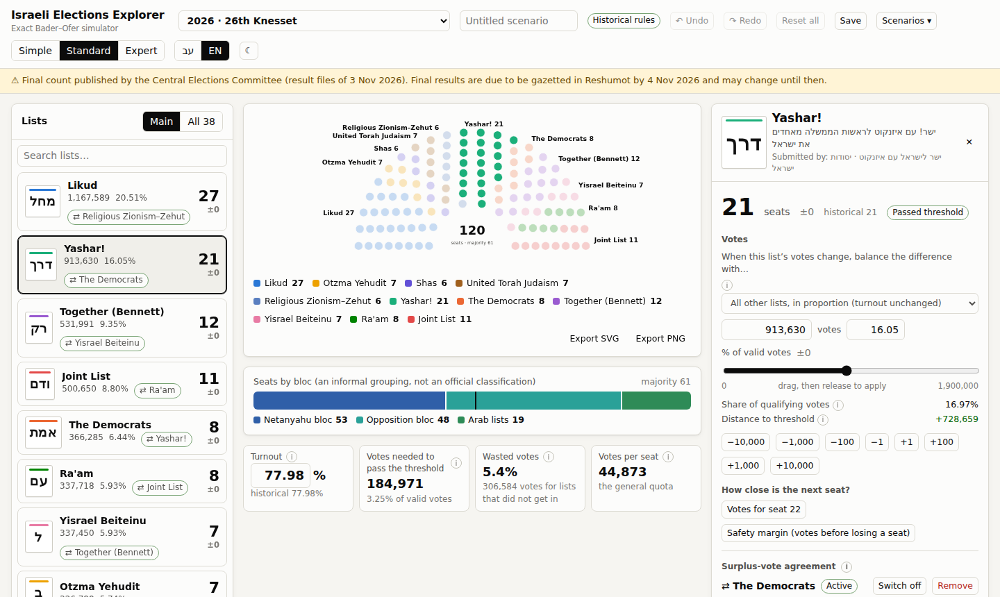

# Israeli Elections Explorer & Simulator · סייר הבחירות לכנסת

Explore Israeli Knesset election results and see how changing votes changes the 120 seats.
This bilingual Hebrew/English app is for curious voters, students and anyone who wants to
understand seat allocation, with detailed tools for researchers and developers.



## What you can do

Choose an election, select a list and change its votes to watch the seats move.
The three interface levels use the same exact engine, with the rules of the chosen election:

| Level | Tools |
|---|---|
| **Simple** (default) | Chamber, list cards, proportionally balanced vote edits, elected candidates with notes, and joint-list parties. Per-election blocs: first government or recognised groupings. “What if…”, coalitions, walkthrough, sources and undo. |
| **Standard** | Adds vote-source choices, comparisons, mergers/splits, surplus agreements, seat security, charts and history. Edit blocs as “Your grouping”, move constituent parties to another bloc, or “Run as separate lists” with editable vote-share assumptions. Save, share, import/export and withdraw/remove lists. |
| **Expert** | Adds candidate/identity editing, turnout, sensitivity, localities and chamber options. Experimental methods include D’Hondt, modified Sainte-Laguë and largest remainder with a Droop quota. Separate runs also show vote counts. |

Hebrew is the default, with right-to-left layout. English and light/dark themes are available.
Info icons open a 47-term bilingual glossary with learn-more links to the law, CEC or
Israel Democracy Institute; terms appear at the relevant interface level. Candidate notes
explain misprints and members replaced before a Knesset’s first sitting, without changing
who the simulation seats.
Lists show the party logo used at that election where a freely licensed copy is held, and
candidates link to their Knesset member page, their party's page and Hebrew Wikipedia (secondary).

## Data and provenance

Votes, candidates and surplus agreements come from Central Elections Committee (CEC),
data.gov.il and Reshumot sources. Raw files and a manifest record source URLs, retrieval
times and SHA-256 hashes. Two 2026 candidate rosters use a labelled secondary source.
Sourced party, bloc and colour research supplements the official results; colours fall back
to the app palette where needed. Short names are app metadata. English Wikipedia is never
used or linked; Hebrew Wikipedia is labelled secondary.

**Available:** all 26 elections from 1949 to 2026. Every member
elected is listed; for 1949–2006 some lists' later candidates (and a few rosters of lists that won no seats) are
not yet transcribed from the scanned gazettes, and the app says so.
See [Data coverage and provenance](docs/DATA.md) for sources, qualifications and gaps.

## Accuracy and limits

The engine uses exact integer and fraction arithmetic for seat decisions. Tests reproduce
every list’s official **2022** seat count exactly, including all 120 seats.
For **2026**, tests reproduce the seat totals reported from the CEC final count; that test’s
comparison figures are labelled as secondary press reports. The dataset has no gazetted
official seat table yet and records final publication as pending as of 3 November 2026.
Availability is recorded in [the election index](public/data/elections.json).

Tests also cover threshold boundaries, surplus agreements, statutory ties and model actions.
An exact tie requires a lottery outcome; the app warns when it is showing a provisional winner.
Large seat searches and vote sweeps can use sampling; exact arithmetic alone does not
guarantee that every smallest change or breakpoint has been found.
See [Electoral law and validation](docs/ELECTORAL-LAW.md).

## Run locally

Install **Node.js 22.18 or later**; CI uses **Node.js 24**. In the project folder:

```sh
npm ci
npm run dev
```

Open the address printed by Vite (normally `http://localhost:5173`).
The production build is a static site; it needs no application backend.

## Tests and checks

```sh
npm test
npm run typecheck
npm run build
npx playwright install chromium
npm run test:e2e
```

The browser tests use the production build, so build before running them.
See [Development](docs/DEVELOPMENT.md) for CI details and test scope.

## Rebuild the data

```sh
npm run data:fetch
npm run data:build
npm test
```

Fetching recovers missing sources; `node scripts/fetch-sources.ts --refresh` downloads
fresh copies. The builder produces every available election's dataset and stops on
failed consistency checks.
Read [Data coverage](docs/DATA.md) before changing sources or publishing rebuilt files.

## Project structure

| Folder | Contents |
|---|---|
| `src/engine/` | Exact allocation and analysis, independent of the interface |
| `src/model/` | Scenario inputs and replayable editing actions |
| `src/app/` | React interface, browser storage and Hebrew/English text |
| `src/data/` | Dataset types and versioning |
| `scripts/` | Source fetching and dataset building |
| `data/raw/` | Retained sources and provenance manifest |
| `data/meta/` | Party, bloc and colour research and sourced candidate notes |
| `public/data/` | Generated datasets loaded by the app |
| `tests/` | Unit, property and browser tests |
| `docs/` | Data, law, development and decision records |

## Documentation

- [Documentation map](docs/README.md)
- [Data coverage and provenance](docs/DATA.md)
- [Electoral law and validation](docs/ELECTORAL-LAW.md)
- [Development](docs/DEVELOPMENT.md)
- [Decision records](docs/decisions/README.md)
- [Contributing](CONTRIBUTING.md)
- [Changelog](CHANGELOG.md)

## Disclaimer

Not affiliated with the Central Elections Committee or any political party.
Blocs are informal, editable groupings, not official electoral classifications.
Scenarios and turnout models are hypothetical, not forecasts. Candidate displays follow
registered lists and do not track later changes in Knesset membership.

## Licence

The code and documentation are released under the [MIT Licence](LICENSE).
The official source documents kept in `data/raw/` (CEC, Reshumot, data.gov.il and others) are
not covered by it and remain under their publishers' terms; see [Data coverage and provenance](docs/DATA.md).
